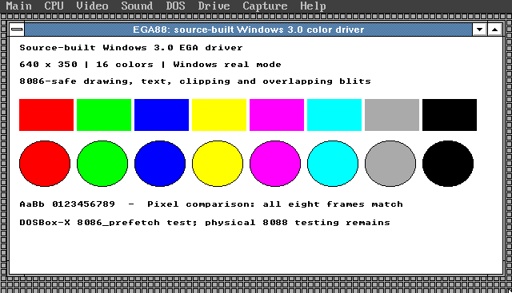
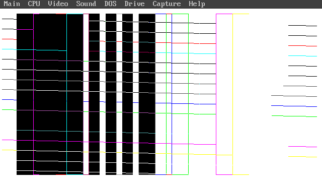

# EGA8088

A source-built Windows 3.0 real-mode EGA driver for 8086/8088-class CPUs, using the original EGA hardware backend at **640 × 350, 16 colors**.

## Why this exists

Windows 3.0 can run in real mode on an 8088, but the stock EGA display driver contains later-CPU instructions. Two direct shifts and the polyline dispatcher use 80186-or-newer encodings. More subtly, its BitBlt compiler generates immediate-count rotates at runtime, so replacing the visible instructions alone is insufficient. The original 8088 also needs special care when an interrupt occurs during a repeated string instruction with a segment override.

This project fixes the source, including the runtime code generator, rather than applying offsets to a particular EGA.DRV binary. It is based on the **retail Windows 3.0 DDK** and matching Windows 3.0 SDK macros. The normal hardware cursor, EGA register operations, four-plane rendering, bitmap conversion and screen-save paths are retained. The protected-mode-only 386 text renderer is not linked; this is an explicitly **real-mode-only** driver.



The screenshot is captured from the actual Windows display surface, not a reconstructed image. [Demo input identity](evidence/DEMO-INPUT.json) and [demo log](evidence/DEMO.LOG) are included.

## Status

The qualified binary is 57,392 bytes, SHA-256:

`3027415d8dc8410bd7bd42ece6e007424df049e9b739642ed3d8eb3967c79ba4`

- All 39 linked modules are rebuilt from source.
- Static audit covers 14,738 emitted instruction rows with no unsupported opcode.
- The linked-byte audit accounts for every CODE/DATA contribution; import libraries add no executable or data bytes.
- All ten overridden repeated-copy sites use 8088-safe loops. Forty-four ordinary single-prefix REP sites remain.
- The clean public build script reproduces the exact qualified binary.
- Source-derived instruction tests pass 290,816 cases plus eight exact-emitter checks; three deliberate mutants are rejected.
- A separate diagnostic build captures 64 actual generated buffers before execution, covering phases 1–7 and 834 one-bit rotates, without observed unsupported encodings. This is not an execution trace or exhaustive bound proof.
- Windows 3.0 real-mode GUI tests pass in DOSBox-X's `8086_prefetch` model and on its 386 model. Eight complete four-plane frame dumps match each other and the stock EGA driver running on the 386 model.

**This is emulator-qualified, not physical-8088 hardware-qualified.** DOSBox-X's 8086-prefetch model is not a cycle-accurate 8088. Real interrupted-prefix behavior, specific EGA cards and physical-machine timing still need hardware testing. The test suite is meaningful coverage, not proof of every GDI input or application.

## Build

The repository contains source, resources, build/audit scripts and the qualified [dist/EGA88.DRV](dist/EGA88.DRV) binary with [SHA-256](dist/SHA256SUMS). It does not include Windows installation files or historical compiler executables.

Requirements:

- Python 3 and an existing DOSBox-X installation.
- MASM 5.10 (`MASM.EXE`).
- Microsoft Segmented-Executable Linker 5.01.17, historically named `LINK4.EXE`.
- `EXE2BIN.EXE` and the Windows 3.0 DDK `SWINLIBC.LIB`.
- An existing, nonempty shared emulator lease file. Use the same lease as other emulator work on that machine. The build never creates/replaces it and refuses to run alongside an existing emulator.

Expected toolchain hashes are in `TOOLCHAIN.json`. Source files are verified against `SOURCE-MANIFEST.json` before building. The `--toolchain` directory may contain subdirectories; the script locates the exact pinned files by name and hash.

```sh
python tools/build.py \
  --toolchain /path/to/historical-toolchain \
  --dosbox /path/to/dosbox-x \
  --lease /path/to/existing-shared-emulator.lock \
  --out /path/to/new-build-directory
```

The resulting `EGA88.DRV`, complete assembler listings, linker map, logs, resource file and audit reports appear in the new build directory. The builder checks the final hash against the qualified binary and fails on differences. The compiler runs on an emulated 386 for speed; `.8086` guards constrain generated driver instructions. Runtime-generated code is handled separately by the source changes and validation.

`BUILD.BAT` is also supplied for a period DOS setup. It expects the prepared build tree mounted as drive R:, with `SRC`, `INC`, `RES`, `BIN` and `LIB`. The Python builder prepares that tree and handles resource packing and audits afterward.

## Try it safely

Use a disposable Windows 3.0 installation for the first test, or retain your existing EGA.DRV so you can restore it. Configure Windows for EGA 640×350, 16 colors (EGA memory greater than 64 KB), then replace that installation's `SYSTEM/EGA.DRV` with the built driver, retaining the original for restoration. Exit Windows completely before changing the driver, then run Windows in real mode (`WIN /R`). To roll back, exit Windows and restore the original EGA.DRV. Keep the EGA system fonts and other matching EGA setup files installed. This is not a VGA 640×480 or Tandy driver, and it rejects protected-mode enablement.

## More screenshots



Intentional GDI test pattern: overlapping rectangles and colored lines exercise all 16 ROP2 drawing modes. This is expected test output, not display corruption, captured from the actual SDL display surface.

## Details

- [Validation coverage and limits](docs/TESTING.md)
- [Reproducible instruction tests](tests/semantics/README.md)
- [Generated-code capture](tests/generated-code/README.md)
- [Source changes and buffer-size bound](docs/CHANGES.md)
- [Original-file and ported-file hashes](docs/SOURCE-ORIGINS.json)
- [Assembly changes](docs/SOURCE.patch)
- [Static ISA audit](evidence/ISA.json), [REP-prefix audit](evidence/REP-AUDIT.json), [link closure](evidence/LINK-CLOSURE.json)

Inspired by Tony814's VGAon8088 work.

## The Center

> Chad Doebelin's Video Card Drivers For Computers Who Can't Do 8-bit external data buses and want to Queue better too?

**The Chad Doebelin Center for Video Card Drivers Who Can’t Do 16-Bit Data Buses Good and Wanna Fetch Instructions Good Too.**

The driver has to be at least… three bytes smaller than this!
